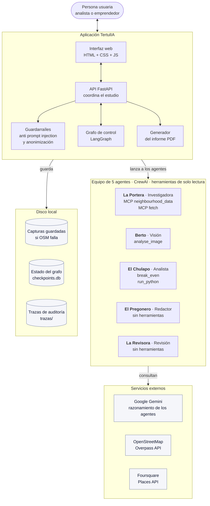
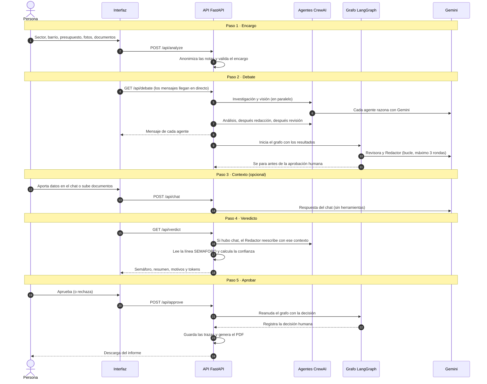
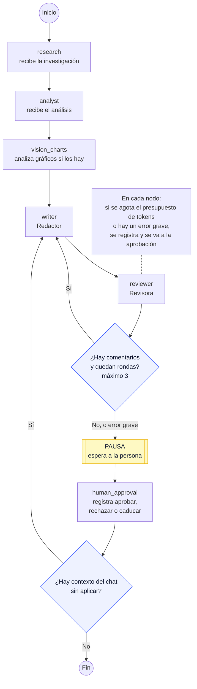

# Arquitectura de TertulIA

Este documento explica cómo está construido TertulIA y cómo viaja un estudio de mercado desde que la persona lo pide hasta que descarga el informe. Tiene tres diagramas, de lo general a lo concreto:

1. **Vista general:** qué piezas hay y cómo se conectan.
2. **Recorrido de un estudio:** qué pasa en cada uno de los 5 pasos de la interfaz.
3. **El grafo de LangGraph:** cómo se controla el bucle de revisión y la aprobación humana.

Al final hay una tabla con las decisiones de diseño y las limitaciones conocidas.

> Los diagramas describen el código de la rama `dev` a 3 de noviembre de 2026 (tras los PR #88 y #90). Si el código cambia, este documento debe actualizarse en el mismo PR.

---

## 1. Vista general

**Cómo leerlo:**

- La **API** es el centro: recibe el encargo de la interfaz, lanza a los agentes, controla el grafo y genera el PDF.
- **Solo dos agentes traen datos de fuera.** La Portera consulta OpenStreetMap y Foursquare a través del servidor MCP propio (`neighbourhood_data`), y webs públicas con el servidor MCP `fetch`. Berto analiza las fotos que sube la persona. Si OpenStreetMap no responde, el servidor usa las capturas guardadas e indica su fecha.
- **El Pregonero y la Revisora no tienen herramientas:** solo trabajan con lo que reciben, para que no puedan traer cifras sin fuente.
- **Todas las herramientas son de solo lectura.** Ninguna envía, publica ni borra nada.
- Todo el texto que llega de fuera (webs, nombres de locales, texto de fotos, documentos y chat) pasa por los **guardarraíles** antes de llegar a un agente.

---

## 2. Recorrido de un estudio

Los 5 pasos son los mismos que ve la persona en la interfaz.

**Lo importante de este recorrido:**

- **Nada sale del sistema sin aprobación humana.** El PDF solo se genera en el paso 5, después de que la persona apruebe.
- El veredicto que se aprueba en el paso 4 es **el mismo** que aparece en el PDF.

---

## 3. El grafo de LangGraph

El grafo es el que decide cuándo repetir, cuándo parar y cuándo esperar a una persona.

**Cómo leerlo:**

- **Bucle de revisión:** si la Revisora pide cambios, el Redactor reescribe con sus comentarios. Como máximo 3 rondas (`MAX_ITERATIONS` en `config/settings.py`).
- **Pausa humana:** el grafo se detiene justo antes de `human_approval` (`interrupt_before`). Su estado se guarda en `checkpoints.db`, y la API lo reanuda cuando la persona decide.
- **Errores graves:** si se agota el presupuesto de tokens (`ERR-006`) o falla un nodo (`ERR-008`), el grafo deja de repetir y va directo a la aprobación humana. Si la persona no responde en 24 h, el estudio caduca (`ERR-009`). Detalle en `docs/errores.md`.

---

## 4. Decisiones de diseño y limitaciones conocidas

| Tema | Cómo es | Por qué | Limitación conocida |
|---|---|---|---|
| CrewAI + LangGraph | CrewAI define los agentes; LangGraph controla el flujo, el bucle y la pausa | Autonomía controlada: el grafo decide, no un agente jefe. Ver `docs/decisiones/0002-proceso-crewai.md` | — |
| Dónde se ejecutan los agentes | Investigación, visión y análisis se ejecutan en la API durante el debate; Redactor y Revisora se ejecutan dentro del grafo | Mostrar los mensajes del debate en directo en la interfaz | Los nodos `research` y `analyst` del grafo solo reciben los datos ya calculados |
| Bucle de revisión | Revisora real, hasta 3 rondas | Que el informe se revise antes de llegar a la persona | La versión reescrita en el bucle no cambia el veredicto ni el PDF, y la Revisora no recibe la investigación ni el análisis completos |
| Semáforo | El Redactor termina con `SEMAFORO: VERDE`, `AMBAR` o `ROJO`, y el código lee esa línea | Evitar deducir el color buscando palabras en el texto | Es una instrucción al modelo: si no escribe la línea, se usa una búsqueda de palabras menos fiable |
| Regla del ámbar | Rojo solo si los números demuestran inviabilidad; ámbar si faltan datos críticos | "No viable" y "no lo sabemos" no son lo mismo (`docs/etica-y-gobernanza.md`) | Depende de que el modelo siga la instrucción |
| Confianza | 1 menos un 10 % por cada "sin dato" del informe y un 5 % por cada fuente sospechosa | Fórmula fija y reproducible | Cuenta la expresión "sin dato" en el texto, no los datos que faltan: puede salir 100 % aunque falten datos |
| Fuentes de datos | OpenStreetMap y Foursquare por MCP; capturas guardadas si OSM falla | Datos reales con fuente y fecha; la demo funciona aunque Overpass caiga | OSM tiene poca cobertura de oficinas y coworkings |
| Trazas | `trazas/<job_id>/traces.jsonl` | Que un tercero pueda auditar la decisión | Hoy registran la decisión humana, no las acciones de cada agente |
| Estado | Grafo en `checkpoints.db`; datos del estudio en memoria de la API | Que el grafo pueda pausarse y reanudarse | Si el servidor se reinicia, los estudios en curso se pierden |
| Modelo | Gemini `gemini-3.5-flash-lite`, configurable en `.env` | Capa gratuita y respuesta rápida | La visión usa el formato de mensajes de Gemini |
